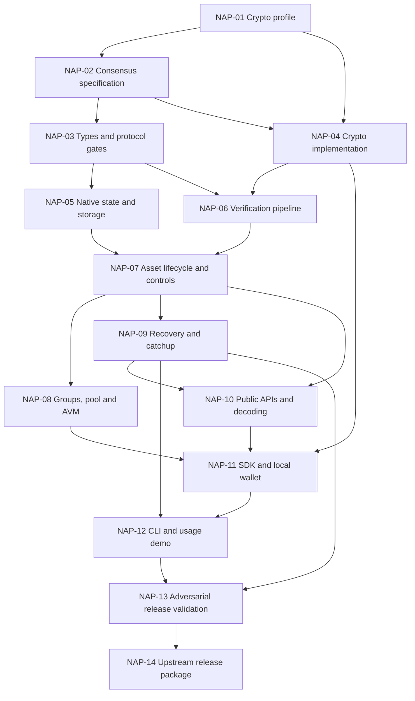

# Native asset privacy: implementation work packages

Read [the north-star plan](README.md) first. This is the execution order for that
plan, not an alternative design. See [live status](END_TO_END_STATUS.md); the
package acceptance criteria below describe the final release target.
Use one focused pull request per reviewable change; a package may require several.

## Working rules for every developer or coding agent

1. Pick the lowest-numbered package whose dependencies have actual completion
   evidence. Read its contract and acceptance tests before editing.
2. Follow `AGENTS.md`. Inspect the current checkout and preserve unrelated work.
   Use `codex/` for new branches unless the user requests otherwise.
3. Follow the current user constraints: 20-line new functions, 100-line authored
   files, disabled defaults, and no tests until requested. Generated lockfiles
   are exempt from the file limit. Build/static checks remain authorized.
4. The user authorized choosing and implementing a pinned, unreviewed candidate
   without a supplied crypto profile. Record parameters in the candidate profile
   and revise dependent code together. Never add permissive verification or mocks.
5. Finish with a handoff: package ID, commit/PR, behavior implemented, checks run,
   measured results, specification changes and next eligible package.

This guide makes implementation work assignable. It does not make cryptographic
design safe merely by assigning work packages. Independent review remains
valuable release evidence, but its absence does not block the authorized candidate
implementation. Contributors should use the pinned contracts and record gaps.

## Dependency map



The graph describes dependencies, not authorization to create chats, delegate
work, publish changes or deploy a network.

## NAP-01 — Freeze the cryptographic profile

**Owner:** cryptography specialist. **Dependencies:** none.

**Deliver:** the exact `PrivacyCryptoProfileV1` described in the plan, a reference
prover/verifier and operation vectors, independently reviewed security analysis,
dependency/license manifest and reproducible performance measurements. Treat
recipient anonymity, required audit encryption and controlled-asset recovery as
part of this profile, not later wallet features.

**Acceptance:** real nonzero shield/spend/unshield and partial-clawback vectors;
rejection of forged witnesses, mismatched ciphertexts and cross-domain proofs;
review of quantum security and actual zero knowledge; finite verifier/allocation
bounds; no classical-security fallback in the proof or encryption chain.

**Handoff:** canonical statement/witness definitions, immutable implementation
revisions, circuit/profile digests, serialization vectors, supported platforms,
and candidate parameters. Candidate integration may proceed before external
review; maintain explicit draft status until the complete relation and limits
are implemented and validated.

## NAP-02 — Freeze the consensus and interoperability specification

**Owner:** protocol engineer with cryptographic review. **Dependencies:** NAP-01.

**Deliver:** a normative proposal in the Algorand specification repository and a
matching implementation contract. Fix transaction tags and operation variants,
body/witness separation, policy immutability/key epochs, native key namespace,
all state transitions, authorization-root freshness, accepted note-root history,
uint64 arithmetic rules, storage charges, block-work limits and error categories.

Specify modes for new and legacy assets, the immutable-manager exclusion,
private-only issuance/exit behavior, registration opt-in and unsolicited-note
handling, key rotation and old-note recovery, partial clawback, asset destruction
and safe state cleanup. Define how ordinary account rekeying relates to the
separate privacy spending/viewing keys; a wallet must never imply that changing
an outer account key automatically revokes all private-note secrets.

**Acceptance:** state-transition tables and executable fixtures cover every
operation and conflict order. Group construction has no proof/transaction-ID
cycle. Freeze and clawback cannot be evaded using older proofs or public/private
conversion. Performance budgets are numeric, reproducible, and compatible with
the target network's block-validation budget.

**Handoff:** approved wire schema, fixtures and exact limits. Assign every
remaining unresolved question to this package; implementation must not proceed
with TODO consensus semantics.

## NAP-03 — Add bounded types, encodings and protocol gates

**Owner:** Go protocol engineer. **Dependencies:** NAP-02.

**Edit areas:** `protocol`, `config`, `data/basics`, `data/transactions`.

**Deliver:** policy references, privacy transaction payloads, separate proof
witness, stable operation/error enums, allocation bounds, consensus parameters,
fee/work contribution definitions, and codecs. Preserve old bytes and behavior
when the feature is absent. Reject orphan private fields on unrelated types.

**Acceptance:** canonical encode/decode vectors; oversized/unknown/noncanonical
input rejection; old-protocol rejection; historical transaction IDs unchanged;
proof mutation changes verification inputs even when the transaction ID is fixed.
Run required `make msgp` and generation verification.

## NAP-04 — Implement the pinned cryptographic package

**Owner:** crypto implementation engineer. **Dependencies:** NAP-01, NAP-02.

**Edit areas:** a focused package under `crypto`, plus a local prover library/tool.

**Deliver:** deterministic bounded verification and approved client-side proving,
encryption and receipt operations. Isolate dependencies behind typed interfaces.
Use the frozen profile's language/FFI choice; porting a verifier is a separate
reviewed implementation, not automatically equivalent to its reference.

**Acceptance:** match independent vectors on amd64 and arm64; differential
prover/verifier tests; fuzz parsers; reject unsupported suites and parameter
overrides; malformed inputs do not panic or allocate without bounds. Prover and
wallet paths protect secrets and use approved randomness.

## NAP-05 — Persist native privacy state and its storage obligations

**Owner:** ledger/storage engineer. **Dependencies:** NAP-03.

**Edit areas:** `ledger/ledgercore`, copy-on-write state, tracker DB accessors.

**Deliver:** typed policy/registration, commitment-tree, root-history, nullifier
and private-supply records in the reserved namespace. Support transactional
updates, deterministic iteration and state minimum-balance accounting. Prevent
collisions with box namespaces and access through AVM box operations.

**Acceptance:** all supported storage backends agree; group/block rollback leaves
no ghost nodes or nullifiers; state-delta reset/reuse is clean; creators cannot
close or withdraw reserved storage balance; atomic third-party funding works;
no privacy state bypasses the storage accounting model.

## NAP-06 — Integrate proof verification and admission limits

**Owner:** transaction verification engineer. **Dependencies:** NAP-03, NAP-04.

**Edit areas:** `data/transactions/verify`, verified cache, verification workers.

**Deliver:** validate outer authorization and private proof as distinct checks.
Perform cheap shape/size/suite checks first. Bind proofs to the final statement
and group. Add bounded worker scheduling, per-peer admission and exact cache
identity. Pure cryptographic acceptance never marks a state-dependent spend valid.

**Acceptance:** invalid proof with a valid outer signature fails; replacing proof
bytes cannot hit a previous successful cache entry; altered group/network/asset/
policy/ciphertext fails; invalid-proof floods stay within queue and memory bounds.

## NAP-07 — Implement native asset lifecycle and issuer controls

**Owner:** ledger execution engineer. **Dependencies:** NAP-05, NAP-06.

**Edit areas:** `ledger/apply`, evaluator dispatch/prefetch, native asset accessors.

**Deliver:** create/enable policy, register, shield, transfer in permitted modes,
unshield, freeze/unfreeze and partial/full clawback with real proofs. Apply current
policy and authorization state; atomically update private/public accounting and
storage obligations. Implement destruction only after full reconciliation.

**Acceptance:** exact conservation across random sequences and maximum uint64
values; same-note double spends within a group, across groups and with clawback
fail; no implicit conversion of existing holdings; issuer control cannot be
weakened through privacy; missing/deleted manager cannot authorize migration;
disallowed modes and stale authorization states fail without partial writes.

## NAP-08 — Complete groups, transaction pool and AVM inspection

**Owner:** evaluator/AVM engineer. **Dependencies:** NAP-07.

**Deliver:** pool accounting/revalidation, per-block deterministic work budgets,
ordinary fee pooling, final-group proof binding and public-only AVM fields.
Keep proofs as top-level transactions. Document the two-party exchange recipe.

**Acceptance:** a failed leg rolls back every leg; altered terms cannot reuse a
proof; pool rechecks after a competing spend, freeze or key rotation; AVM cannot
read private values; max-work admission is identical across architectures.
Regenerate TEAL field/type specifications after AVM-visible additions.

## NAP-09 — Complete replay, restart, catchpoints and catchup

**Owner:** ledger recovery engineer. **Dependencies:** NAP-07.

**Deliver:** snapshot/catchpoint serialization and import for all privacy state,
version negotiation/rejection, history retention and membership data rebuilding.
Assess the existing KV snapshot path; use a new format version where changed
semantics require it, following NAP-02's compatibility contract.

**Acceptance:** replayed and imported nodes agree on private supply, roots,
nullifiers, policies and next valid spends. Crash-injection around commit is
atomic. A fresh catchup node can verify existing notes and serve the promised
witness data. Pruning cannot resurrect a spend or silently invalidate ownership.

## NAP-10 — Ship public APIs and downstream transaction decoding

**Owner:** API/SDK integration engineer. **Dependencies:** NAP-07, NAP-09.

**Deliver:** round-qualified bounded endpoints in the plan, OpenAPI schemas,
simulation/error reporting, generated clients and indexer/explorer decoding.
Expose ciphertexts/public metadata only. Preserve accurate absent/unknown values.

**Acceptance:** pagination and concurrent reads are consistent; tracker reads hold
`trackerMu.RLock()`; stale rounds and retention gaps are explicit; malformed
requests are bounded; no plaintext or keys in responses/logs. If shared paginated
resource lookup code changes, keep asset/application/box implementations aligned
as required by `AGENTS.md`.

## NAP-11 — Build the Go SDK and local privacy wallet

**Owner:** SDK/wallet engineer. **Dependencies:** NAP-04, NAP-08, NAP-10.

**Deliver:** operation builders, group-then-prove workflow, local proof generation,
private key storage, encrypted backup, public-stream scanning and witness
maintenance, receipt verification and explicit stale-proof retries. Keep the
prover outside the node RPC boundary. Produce reusable Go examples and vectors
that future language SDKs can implement.

**Acceptance:** an SDK transaction validates on a real node; wrong network/asset/
recipient fails safely; recovery restores spending and viewing across key epochs;
view-only material cannot authorize spends; default shielded scanning avoids
owner-specific RPC lookups; no witness upload to remote services. Test account
rekey and private-key rotation as distinct operations under the frozen contract.

## NAP-12 — Add the CLI and production-backed demo

**Owner:** developer tooling engineer. **Dependencies:** NAP-11, NAP-09.

**Deliver:** documented `goal` commands and a local dashboard/example with a
repeatable setup/run/verify workflow. Use four or more ordinary configured nodes,
the actual SDK and real proofs. Show public, holder, auditor and controller views
without putting all users' secrets into one remote backend.

**Acceptance:** all six scenarios in the plan pass unattended, including the
tampered atomic group, backup restoration and controlled-asset scenario. A second
machine can reproduce the demo from the documented build. Published sample
credentials are test-only and never mixed with live wallets.

## NAP-13 — Complete adversarial and release validation

**Owner:** security/performance and protocol engineers. **Dependencies:** NAP-08
through NAP-12; independent audit findings may reopen any earlier package.

**Deliver:** final cryptography and implementation audits; sustained multi-node
mixed workloads; resource, latency and disk-growth reports; fuzz/race results;
upgrade/rollback behavior documentation and suite migration tests. Retest all
changes made after audit against its assumptions.

**Acceptance:** no unresolved security findings affecting launch guarantees;
all NAP-02 budgets met on reference hardware; repeated roots/nullifiers and
concurrent sender/controller conflicts handled consistently; replays and catchup
agree; negative privacy tests inspect transactions, RPC, logs and wallet artifacts
for unintended plaintext or identifying fields. Such tests supplement the
cryptographic argument; they cannot prove unlinkability on their own.

## NAP-14 — Assemble the upstream-ready release

**Owner:** release/protocol maintainer. **Dependencies:** NAP-13.

**Deliver:** coordinated node/specification/SDK/indexer changes, reproducible
builds, dependency licenses and audit reports, migration/operator/developer docs,
API/codegen artifacts, upgrade fixtures and the verified demo. Record the release
candidate's exact commits and profile/specification hashes.

**Acceptance:** required CI, repository checks and subject-matter reviews pass;
all evidence for G1-G5 is attached. The feature is ready for an upstream release
decision. Do not report upstream merge, public-testnet activation or mainnet
approval as completed unless those external events actually occurred.

## Verification checklist

Use targeted package tests while developing, then the repository's required
release checks. Test names below describe scenarios, not pre-existing functions.

| Scenario | Required result |
| --- | --- |
| Public/private conversion and partial withdrawal | Exact public + private supply conservation |
| Negative/overflow/range-invalid value | Rejected by proof/ledger rules |
| Replay, duplicate nullifier, holder vs clawback | At most one valid consumption |
| Old authorization root after freeze/rotation | Rejected; SDK reports rebuildable stale state |
| Different group, genesis, ASA or ciphertext | Original proof no longer verifies |
| Missing policy / unsupported mode / immutable legacy manager | Deterministic rejection |
| False audit ciphertext / unauthorized auditor | Rejected or unable to decrypt as appropriate |
| Changed receipt or viewing key used to spend | Verification/authorization fails |
| Storage shortfall / oversized proof / saturated verification queue | Bounded failure without partial state changes |
| Crash, replay, catchpoint import, pruned history | Same consensus state; explicit history limitations |
| Old protocol / new protocol activation boundary | Historical behavior preserved; feature gated correctly |
| Public/confidential/shielded inspection | Only the mode's declared data is exposed |

Relevant commands from `AGENTS.md`:

```sh
go test ./data/transactions/... ./ledger/apply/... ./ledger/eval/...
go test ./crypto/... ./ledger/store/trackerdb/...
make fulltest
make integration
make sanity
make msgp
make generate
make -C daemon/algod/api generate
```

Run only the generation targets relevant to changed files and include their
outputs. Follow `scripts/travis/codegen_verification.sh` before release. For E2E,
rebuild node binaries first and set `NODEBINDIR`, `TESTDATADIR` and `TESTDIR` per
`AGENTS.md`. An unavailable external audit or sibling repository is an explicit
remaining dependency, never a passing check.

## Copyable implementation prompt

> Implement NAP-XX from docs/native-asset-privacy/IMPLEMENTATION.md. First read
> AGENTS.md, the north-star README, the frozen crypto/consensus specifications,
> and the named dependency handoffs. Confirm that prerequisites have evidence.
> If a security-critical specification is missing, document the candidate choice
> and its unresolved obligations; never bypass verification. Respect the user’s
> test deferral and authored size limits. Keep changes focused, run
> appropriate checks, and finish with an evidence-based handoff. Do not report
> the overall native-privacy feature complete from this package alone.
